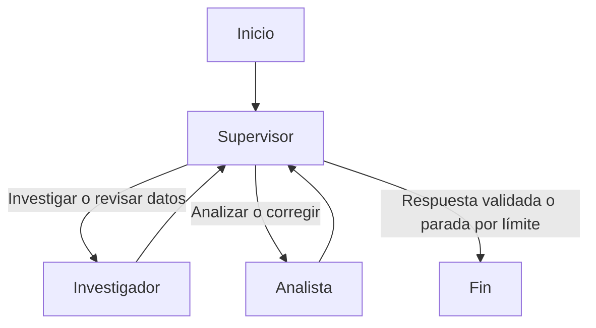

# Preentrega 6 — Orquestador multiagente especializado

Prototipo de investigación y análisis de ventas con LangGraph.
Un supervisor coordina dos especialistas, valida sus resultados
y genera una respuesta final.

El proyecto incluye un modo local reproducible sin consumo de
créditos y un modo con agentes conectados a OpenAI.

## Arquitectura

Se utiliza una topología jerárquica: los especialistas devuelven
siempre el control al supervisor. Este decide el siguiente destino
mediante aristas condicionales.



Esta topología centraliza la delegación y la validación. Permite
solicitar revisiones sin que los especialistas se llamen directamente.

## Componentes

| Archivo | Función |
|---|---|
| `state.py` | Define el estado compartido mediante `MessagesState`. |
| `config.py` | Lee `.env` y configura el cliente de OpenAI. |
| `agents/research_agent.py` | Recupera datos mediante una consulta SQLite. |
| `agents/analyst_agent.py` | Valida registros y calcula facturación. |
| `supervisor.py` | Decide el flujo, valida y sintetiza resultados. |
| `main.py` | Construye el grafo y ejecuta la demostración. |
| `requirements.txt` | Registra las versiones de las dependencias. |
| `.env.example` | Proporciona un ejemplo de configuración. |

## Herramientas

### Investigación

`search_sales()` consulta una base SQLite creada en memoria con
datos ficticios de llaveros, miniaturas y dummys.

En modo API, el investigador accede a esta función mediante
`search_sales_database`. Los registros del estado provienen
directamente de la herramienta, no del texto generado por el modelo.

La búsqueda es local: no consulta Internet ni fuentes comerciales reales.

### Análisis

`analyze_sales()` comprueba productos, cantidades, precios,
moneda y fuentes. Calcula:

- Facturación por producto: unidades × precio unitario.
- Facturación total.
- Unidades totales.
- Productos con mayor facturación, incluyendo empates.

Utiliza `Decimal` para los cálculos monetarios y almacena los
importes calculados como cadenas.

En modo API, el analista accede al cálculo mediante `calculate_sales`,
que toma los datos directamente del estado compartido.

## Estado compartido

`OrchestratorState` conserva la solicitud original, mensajes,
datos de investigación, resultados de análisis, aportes de cada
agente, observaciones de validación y respuesta final.

También registra el destino elegido, el número de intervenciones,
el límite de pasos y si la tarea se completó con éxito.

El flujo principal es secuencial. El estado conserva el contexto
entre intervenciones; este prototipo no ejecuta especialistas en paralelo.

## Modos de ejecución

### Modo local

Utiliza reglas de Python para delegar y generar los resúmenes.
Ejecuta herramientas reales de consulta y cálculo, pero no utiliza
un modelo de lenguaje.

No requiere una API key ni consume créditos.

### Modo API

Utiliza `ChatOpenAI` y especialistas creados con `create_react_agent`.
El supervisor recibe una decisión estructurada con Pydantic y
`with_structured_output`.

Requiere una API key con créditos y un modelo compatible con
llamadas a herramientas y salida estructurada mediante function calling.

El modo API está implementado, pero no se ha probado con llamadas
reales por no disponer de créditos.

## Instalación

Crear y activar un entorno virtual. Luego ejecutar:

```bash
python -m pip install -r requirements.txt
```

SQLite forma parte de la biblioteca estándar de Python y no
requiere instalar un servidor.

Copiar `.env.example` como `.env` en la carpeta principal.
En PowerShell:

```powershell
Copy-Item .env.example .env
```

## Configuración y ejecución local

Contenido de `.env`:

```dotenv
RUN_MODE=local
OPENAI_API_KEY=
OPENAI_MODEL=
```

Ejecutar:

```bash
python main.py
```

La terminal muestra las intervenciones y la respuesta final.

## Configuración del modo API

En `.env`, configurar:

```dotenv
RUN_MODE=api
OPENAI_API_KEY=tu_clave
OPENAI_MODEL=nombre_de_un_modelo_compatible
```

Reemplazar los valores de ejemplo y ejecutar:

```bash
python main.py
```

Este modo realiza llamadas pagas a OpenAI. La creación del cliente
comprueba la presencia de la clave y del modelo, pero no verifica
su validez ni el saldo de la cuenta.

Las variables ya definidas en el entorno tienen prioridad sobre `.env`.

## Validación y manejo de conflictos

El supervisor local recalcula los resultados desde los registros
originales y los compara con los resultados del analista.

En modo API, además aplica una rúbrica en su prompt para revisar:

- Correspondencia entre la solicitud y los productos recuperados.
- Presencia de los campos y las fuentes requeridas.
- Coincidencia de las explicaciones con los cálculos.
- Distinción entre facturación y ganancia.
- Identificación de los datos como ficticios.

Las discrepancias generan observaciones en `validation_feedback`
y una nueva delegación. Una investigación nueva invalida los
cálculos anteriores.

La revisión de texto realizada por el modelo puede equivocarse.
La validación numérica utiliza la misma función de cálculo que
el analista: comprueba consistencia, pero no es una implementación
independiente de la fórmula.

## Condiciones de parada

- Hasta dos intervenciones por especialista.
- Límite de 10 intervenciones previas a la comprobación de parada.
- La intervención que informa la parada también incrementa el contador.
- Límite de recursión de 30 para el grafo principal.
- Límite de recursión de 12 para cada agente ReAct.

Finalizar por falta de datos o por límites deja
`task_completed=False`. Solo una finalización exitosa marca
la tarea como completada.

Los errores de API, las salidas estructuradas inválidas y el
agotamiento del límite interno de un agente se propagan como
excepciones; no se presentan como tareas completadas.

## Gestión del contexto

Los especialistas con IA reciben únicamente la solicitud,
las observaciones pertinentes y, para el analista, los datos
recuperados. No reciben todo el historial del sistema.

El supervisor recibe los datos y resúmenes necesarios para decidir.

## Demostración local verificada

Consulta:

> Investigá las ventas de llaveros, miniaturas y dummys.
> Calculá la facturación de cada producto y el total,
> e indicá cuál generó más ingresos.

| Producto | Unidades | Precio unitario ARS | Facturación ARS |
|---|---:|---:|---:|
| Llaveros | 50 | 1.300 | 65.000 |
| Miniaturas | 12 | 4.500 | 54.000 |
| Dummys | 8 | 6.500 | 52.000 |
| **Total** | **70** | — | **171.000** |

El flujo local termina en cinco intervenciones:
supervisor, investigador, supervisor, analista y supervisor.

La facturación no representa ganancia: no se incluyen costos.

## Alcance y limitaciones

El catálogo y sus ventas son ficticios y se recrean en cada consulta.
La búsqueda local usa coincidencias de palabras, por lo que no
interpreta todas las expresiones, exclusiones o productos desconocidos.

El modo local demuestra la orquestación con reglas. El modo API
incorpora interpretación y revisión mediante un modelo de lenguaje.

Las validaciones no garantizan que los datos representen ventas
reales ni que el texto generado esté libre de errores.

## Comprobación de dependencias

```bash
python -m pip check
```

Resultado obtenido:

```text
No broken requirements found.
```

## Credenciales

`.env` y el entorno virtual se excluyen mediante `.gitignore`.
El archivo `.env.example` se incluye sin credenciales.

## Notebook de demostración

El archivo [demo.ipynb](demo.ipynb) incluye las salidas de una
ejecución local y muestra:

- La delegación entre supervisor, investigador y analista.
- La respuesta final y el registro de aportes.
- La comprobación de 70 unidades y ARS 171.000 de facturación.
- La finalización con tarea incompleta ante una consulta sin datos.

Para volver a ejecutarlo desde PowerShell:

```powershell
python -m ipykernel install --user --name entregable6 --display-name "Python Entregable 6"
python -m nbconvert --to notebook --execute --inplace --ExecutePreprocessor.kernel_name=entregable6 demo.ipynb
```

`create_demo_notebook.py` genera el notebook vacío. No debe ejecutarse
después de la demostración si se quieren conservar sus salidas.